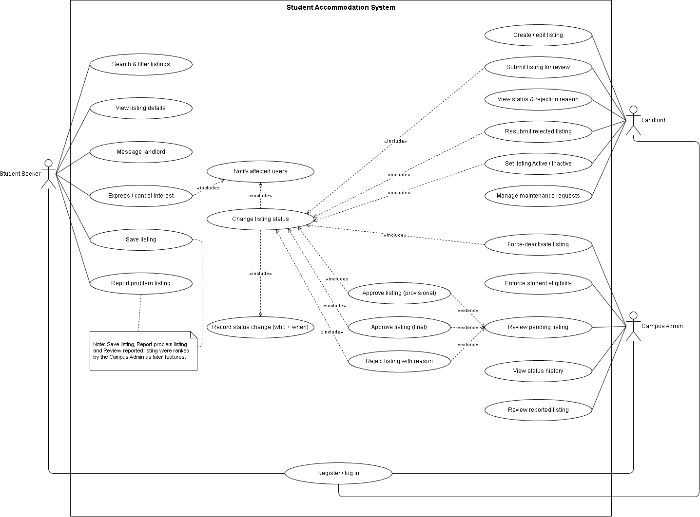
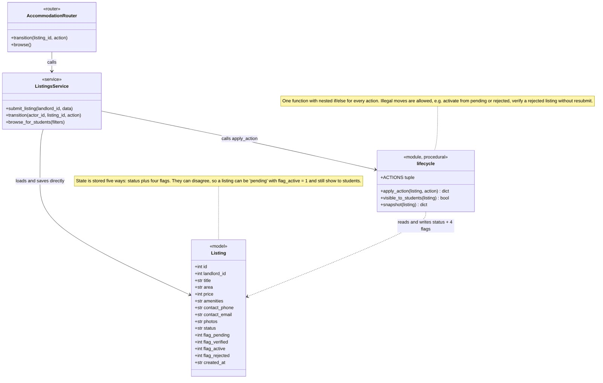
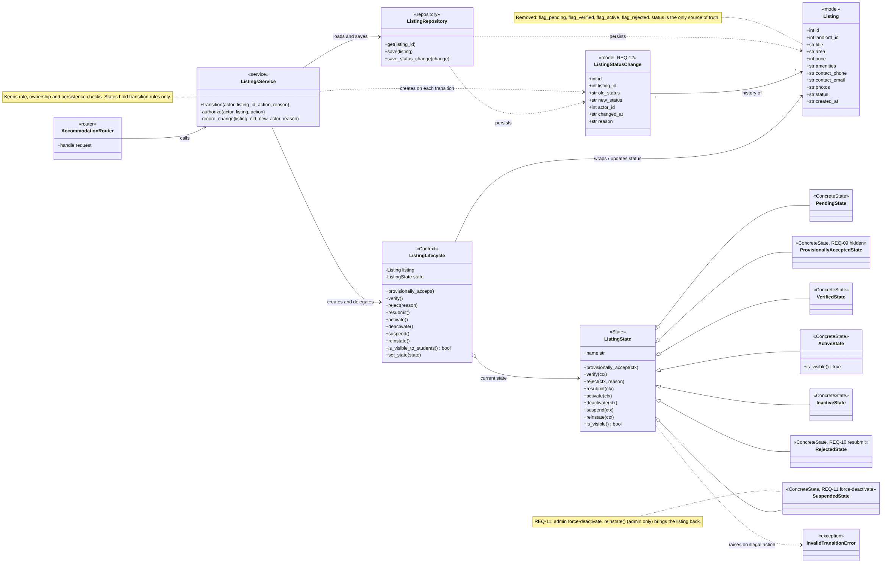

# Cover Page

## Course
COMP 3613

## Project Title
Student Accommodation

## Group Name
Bits & Giggles

## Scenario
Student Accommodation

## Date
17 Nov 2026

# Group Members

| Name | Student ID | GitHub username |
| --- | --- | --- |
| Kirese Maharaj | 816040048 | KireseTashaMaharaj |
| Raymond Sookdeo | 816044791 | Cyborg2169 |
| Keon Cummings | 816042834 | Zydem |
| Calliste Charles | 816036888 | calliste2003 |

Calliste's commits appear under his second GitHub account, madmancharlo-png.

# Assigned Project Details

## Scenario summary
The project scenario is Student Accommodation, a referral-based off-campus housing listing platform with a restricted campus model. The repo contains the starter project and the assignment text that frames the challenge as a student accommodation listing and lifecycle problem. Source: [README.md](../README.md), [ASSIGNMENT.md](../ASSIGNMENT.md), and [docs/ACCEPTANCE.md](ACCEPTANCE.md).

## Special feature
The special feature is the listing lifecycle and transitions: submission → pending → admin verification/rejection → active/inactive visibility rules. This is the feature explicitly called out in [ASSIGNMENT.md](../ASSIGNMENT.md) and the interview evidence in [docs/interviews/student-accommodation-interview.md](interviews/student-accommodation-interview.md).

## Why we chose it over other scenarios interviewed
We interviewed stakeholders for the Job Board and Career Advising scenarios before choosing Student Accommodation. We chose it because our group members had worked in this domain before, also because the Campus Accommodation Admin gave clear rules for each stage of a listing, which gave us a very detailed special feature to design. The Job Board had a similar lifecycle but its administrator reported no major issues with it and the Career Advising concerns were mostly about outdated data and the interface.

# Repo URL and Trello invite link

- Repo URL: https://github.com/KireseTashaMaharaj/comp3613-student-accommodation
- Trello invite link: https://trello.com/invite/b/6afa14e50c61eaff6fe541ca/ATTIe681ab9ba7da000f241b3afd0602f0c681B3A252/comp-3613-bits-giggles

# Requirements

| ID | Type | Requirement | Priority | Acceptance note | Source |
| --- | --- | --- | --- | --- | --- |
| REQ-01 | Functional | Acceptance criteria: only eligible students can browse listing details using a registered student ID or provisional incoming pathway. | Must | A student with a registered student ID or provisional incoming pathway can access listing detail pages; a non-eligible user cannot. | docs/ACCEPTANCE.md — “only eligible students browse listing details (registered student ID or provisional incoming pathway).” |
| REQ-02 | Functional | Acceptance criteria: listings are limited to the St. Augustine and Mount Hope areas. | Must | A listing outside St. Augustine or Mount Hope is not returned in student search results for St. Augustine students. | docs/ACCEPTANCE.md — “St. Augustine / Mount Hope listings for St. Augustine students.” |
| REQ-03 | Functional | Acceptance criteria: the platform is referral-only; no payments, contracts, or booking checkout. | Must | A student cannot complete a payment, contract, or booking checkout flow in the platform. | docs/ACCEPTANCE.md — “Referral only — optional in-app messages OK; no payments, contracts, or booking checkout.”<br>docs/interviews/student-accommodation-interview.md — “It's a referral system, so they deal directly with the landlords.” |
| REQ-04 | Non-functional | Acceptance criteria: passwords are hashed and login never reveals password material. | Must | A login response does not include the user’s password or password hash, and stored credentials are hashed. | docs/ACCEPTANCE.md — “Passwords hashed; login never returns password material.” |
| REQ-05 | Functional | SPECIAL FEATURE — Listing lifecycle: landlord submit → pending → campus admin verify or reject → landlord may set active or inactive. | Must | A landlord-submitted listing enters pending state; after admin approval or rejection, the listing reaches its next allowed state and is only visible if approved and active. | docs/ACCEPTANCE.md — “Landlord submit → pending → campus admin verify (or reject) → landlord may set active / inactive.”<br>docs/interviews/student-accommodation-interview.md — “When a landlord submits a listing, it first goes into a pending state. From there, I review it to make sure everything checks out. If it meets our criteria, I can either approve it or reject it.” |
| REQ-06 | Functional | SPECIAL FEATURE — Pending and rejected listings are hidden from student seekers; activation only after verification; status and visibility stay consistent. | Must | A provisionally accepted listing does not appear in student search results; a rejected listing does not appear in student search results; a listing cannot be activated before admin approval. | docs/ACCEPTANCE.md — “Pending and rejected listings are not visible to student seekers.”; “Activate is only allowed after verification (not from pending/rejected).”; “Status and visibility must stay consistent (one clear current state).”<br>docs/interviews/student-accommodation-interview.md — “If I approve it, it can get a provisional acceptance first, which means it’s still hidden from students until I do a final review.” |
| REQ-07 | Functional | Acceptance criteria: students can filter by location, price, and amenities and see landlord contact information on visible listings. | Must | A student can filter visible listings by location, price, and amenities; the contact details of a visible listing are available only according to the allowed visibility rules. | docs/ACCEPTANCE.md — “Students filter by location, price, and amenities; see landlord contact info on visible listings.”<br>docs/interviews/student-accommodation-interview.md — “Right now, students use the system to browse and filter through approved listings based on location, price, and amenities.” |
| REQ-08 | Functional | Acceptance criteria: messaging may be used only against listings students are allowed to see. | Should | A student can start an in-app message only for a listing that is visible to that student. | docs/ACCEPTANCE.md — “Optional message threads only against listings students are allowed to see.”<br>docs/interviews/student-accommodation-interview.md — “Next, I'd prioritize the in-app messaging feature. It’s crucial for students to communicate with landlords directly...” |
| REQ-09 | Functional | SPECIAL FEATURE — Provisional acceptance: an approved listing can remain hidden until final admin review. | Must | A provisionally accepted listing does not appear in student search results until final approval is complete. | docs/interviews/student-accommodation-interview.md — “If I approve it, it can get a provisional acceptance first, which means it’s still hidden from students until I do a final review.” |
| REQ-10 | Functional | SPECIAL FEATURE — Rejected listings must include a reason and must go through revision and resubmission before they can become active again. | Must | A rejected listing includes a rejection reason visible to the landlord, and a rejected listing cannot become active without a new admin review after resubmission. | docs/interviews/student-accommodation-interview.md — “If I reject it, I might provide a reason, and the landlord can revise and resubmit it.”<br>docs/interviews/student-accommodation-interview.md — “As for rejected listings, they can't go active again until I've reviewed them and given my approval.” |
| REQ-11 | Functional | SPECIAL FEATURE — Admin force-deactivation is allowed when a listing becomes unsuitable, and the landlord cannot reactivate it without admin approval. | Must | A force-deactivated listing stays hidden from student search results until an admin re-approves it; the landlord cannot reactivate it directly. | docs/interviews/student-accommodation-interview.md — “If at any point a listing becomes unsuitable, I can force-deactivate or unpublish it.”<br>docs/interviews/student-accommodation-interview.md — “Once I force-deactivate a listing, the landlord can't reactivate it without my approval.” |
| REQ-12 | Functional | SPECIAL FEATURE — A record of who changed a listing status and when must be kept. | Must | Each listing-status change is stored with an actor and timestamp, and the record is available for review. | docs/interviews/student-accommodation-interview.md — “Yes, we do keep a record of who changed a listing's status and when.” |
| REQ-13 | Functional | Listing edits do not automatically send an approved listing back to pending. | Should | Editing an approved listing does not automatically reset the listing to pending unless the admin decides it needs review. | docs/interviews/student-accommodation-interview.md — “If a landlord edits an already approved listing, it doesn't automatically go back to pending.” |
| REQ-14 | Functional | Landlords are notified when a listing is approved, rejected, or removed. | Should | A landlord receives a platform notification when a listing is approved, rejected, or removed. | docs/interviews/student-accommodation-interview.md — “When I approve, reject, or remove a submission, landlords get notified through the platform.” |
| REQ-15 | Functional | Landlords can see and manage their own listings only. | Must | A landlord can access and modify only listings they own; they cannot view or edit another landlord’s listings. | docs/interviews/student-accommodation-interview.md — “Only certain users can see or change specific things. For example, landlords can see and manage their own listings...” |
| REQ-16 | Non-functional | The platform should be usable on phones and should load quickly for students and landlords. | Should | A mobile user can browse and load listing pages on a phone without waiting more than a few seconds. | docs/interviews/student-accommodation-interview.md — “And yes, the platform should be mobile-friendly since many students and landlords will likely use it on their phones.”<br>docs/interviews/student-accommodation-interview.md — “I mostly use my phone for this kind of stuff because it’s easier to browse on the go. As for loading speed, I’d say if it takes more than a few seconds, I’d start getting annoyed.” |
| REQ-17 | Functional | A student can click an “interested” button and later cancel it, and the landlord is notified. | Should | A student can cancel a previous interest action, and the landlord is notified that interest has been withdrawn. | docs/interviews/student-accommodation-interview.md — “Absolutely, if I clicked 'interested' but then changed my mind or found another place, I should definitely be able to cancel that interest.”<br>docs/interviews/student-accommodation-interview.md — “Once I cancel, I think the landlord should be notified that I’m no longer interested.” |
| REQ-18 | Functional | The app notifies a student when a saved listing is taken or the price changes. | Could | A student receives a notification when a saved listing has become unavailable or its price changed. | docs/interviews/student-accommodation-interview.md — “Yes, I’d definitely appreciate it if the app notified me if a place I saved got taken or if the price changed.” |
| REQ-19 | Functional | SPECIAL FEATURE — The app reminds landlords to update stale listings and can auto-hide them if they remain stale. | Should | A stale listing triggers a reminder to the landlord; if it remains stale for a period, it is hidden or marked inactive automatically. | docs/interviews/student-accommodation-interview.md — “If the landlord forgets to update the listing, I think the app should definitely send a reminder to them.”<br>docs/interviews/student-accommodation-interview.md — “But if it’s been weeks and nothing has changed, it might be a good idea for the app to automatically hide the listing or mark it as inactive.” |
| REQ-20 | Functional | Landlords can track inquiries and students can book viewing slots. | Should | A landlord can track who is interested and when, and a student can book a viewing time slot without extra back-and-forth messages. | docs/interviews/student-accommodation-interview.md — “I’d want it to keep track of inquiries and visits...”<br>docs/interviews/student-accommodation-interview.md — “I think having a system where they can book a time slot themselves would be super helpful.” |
| REQ-21 | Functional | Students may save and compare listings in a future enhancement. | Could | A student can save favourite listings and compare them side-by-side in a future enhancement. | docs/interviews/student-accommodation-interview.md — “Students have asked for more features like saving their favorite listings and maybe even a way to compare them side-by-side. Those are good ideas, but we haven't implemented them yet.” |
| REQ-22 | Functional | A student may report a problem listing to help maintain reliability. | Could | A student can report an inaccurate or problematic listing to the admin or platform team. | docs/interviews/student-accommodation-interview.md — “Reporting a problem listing is something we definitely want to consider, as it would help us keep the platform reliable.” |
| REQ-23 | Non-functional | All users need to log in to access the platform. | Must | Access to the platform is restricted to authenticated users, with students authenticated by student ID and landlords by user login. | docs/interviews/student-accommodation-interview.md — “Yes, all users need to log in to access the platform. Students must authenticate with their student ID to browse listings, and landlords need to log in to manage their listings. This keeps everything secure and ensures that only eligible users can access the information they need.” |
| REQ-24 | Functional | Landlords need to be able to create and submit a listing, and they can also edit it if they want to update details or add photos. | Must | A landlord can create, submit, and edit a listing, including updates to details and photos before the listing enters the admin review process. | docs/interviews/student-accommodation-interview.md — “Landlords need to be able to create and submit a listing, and they can also edit it if they want to update details or add photos.” |

## Out of scope

The following items are explicitly out of scope for this referral-only accommodation platform because they break the referral-only rule and are not part of a tenancy-management system:

- Payments and recurring payment handling: “I think having the app handle payments could be convenient, especially if it allows for recurring payments.”
- Deposits: “As for deposits, I do take one, usually about a month's rent.”
- Leases and tenancy terms: “The length of the lease usually depends on the student’s needs...”
- Maintenance requests and emergency repair handling: “One thing that might be worth mentioning is how I handle maintenance requests...” and “If a student needs something fixed, like the AC...”

## Assumptions

- The public acceptance criteria say students see contact info on visible listings, but the admin interview says: “Privacy is a big deal, so we make sure that contact details are only visible to students once they’re interacting with the landlord directly.” This product decision conflict should be treated as an assumption to confirm.
- No additional product assumptions were introduced beyond the stakeholder statements above.

# Use case diagram



## Actor notes
- Student Seeker: browses visible listings, applies location/price/amenity filters, and may communicate only with eligible listings.
- Landlord: submits listings, manages their own listings, and responds to inquiries.
- Campus admin: verifies or rejects listings and enforces the lifecycle rules.

# Class diagram and pattern rationale

## Inherited structure



## Proposed design (State pattern)



## Pattern rationale

## Special feature: listing lifecycle and transitions

**Inherited weakness.** `app/models/listing.py` stores a free-form `status`
plus four integer flags (`flag_pending`, `flag_verified`, `flag_active`,
`flag_rejected`); the model's own comment says the label often drifts from
them. `app/services/lifecycle.py` `apply_action()` is a single conditional
chain whose defect notes identify skipped verification, stale flags,
rejected-listing activation, and invalid deactivation.
`visible_to_students()` separately checks the active flag or status.
Inactive is the status `inactive` with `flag_active` set to `0`.
`app/services/listings.py` `transition()` persists both representations and
omits landlord ownership checks. Role checks are in
`app/services/listings.py`, and transition rules are in
`app/services/lifecycle.py`. Nothing records who changed a status.

**Pattern: State.** Allowed actions depend on the current state, so a
`ListingLifecycle` Context wraps `Listing` and delegates each action to a
`ListingState`. Seven concrete states (Pending, ProvisionallyAccepted,
Verified, Active, Inactive, Rejected, Suspended) allow only legal
transitions and raise `InvalidTransitionError` otherwise. `status` becomes
the single source of truth, the four flags are removed, and visibility is
derived from `ActiveState`.

The interviews [docs/interviews/student-accommodation-interview.md](interviews/student-accommodation-interview.md) add four
requirements the design covers:
- REQ-09: `ProvisionallyAcceptedState`, approved but hidden from students.
- REQ-10: `resubmit()` returns a Rejected listing to Pending.
- REQ-11: `SuspendedState` is the admin force-deactivate; an admin-only
  `reinstate()` restores the listing.
- REQ-12: a `ListingStatusChange` record (listing, old status, new status,
  actor, time, reason) is created on every transition.

**Layering.** Routes call `ListingsService`, which authorizes (role and
ownership), runs the Context, creates the `ListingStatusChange`, and saves
both through `ListingRepository`. State classes hold transition rules only.

**Alternatives.** Strategy is a weaker fit: this is state-dependent
behaviour, not interchangeable algorithms. An enum or transition table with
a central validator is viable, but it keeps the logic centralized as rules
grow and gives no home for per-state behaviour such as visibility.

### Assumptions

- `ProvisionallyAccepted` and `Suspended` come from the interviews.
- Pending may go straight to Verified.
- `reinstate()` returns the listing to Active.

**Sprint 2 outline.** Replace the chain in `app/services/lifecycle.py` with
the Context and state classes. Remove the flags from
`app/models/listing.py` and persistence. Add `ListingStatusChange` and
`ListingRepository`. Update `app/services/listings.py` to delegate,
authorize, record, and persist the canonical status. Change
`app/routers/accommodation.py` only if needed. Test allowed and rejected
transitions per state, authorization including ownership, persistence and
history, visibility, and API behaviour end to end.

# Interview transcripts

## Scenario: Student Accommodation | Persona: Campus Accommodation Admin | Date: 15 Nov 2026

```text
COMP 3613 BITS&GIGGLES CHOSEN INTERVIEW
Chosen Scenario Interview 1: Student Accommodation 
Hi, thanks for meeting with us. Could you tell me a bit about your role and how the student accommodation system is mainly used right now?
03:39 PM
vector:student-accommodation:campus_admin · openai · gpt-4o-mini
Sure! I'm the Campus Accommodation Admin, so my main job is to manage the housing referral platform for our students. I verify landlord listings, approve or reject them, and make sure everything's suitable for our students.
Right now, students use the system to browse and filter through approved listings based on location, price, and amenities. They can also contact landlords directly if they want to arrange visits or ask questions. It's all about helping them find verified off-campus housing without us handling any payments or contracts. It's a referral system, so they deal directly with the landlords.
03:39 PM2.6s
You mentioned you verify approve or reject listings. can you walk me through how it works from when a landlord first submits itto when its no longer on the platform? like what stafes it goes through and who moves it on
03:43 PM
vector:student-accommodation:campus_admin · openai · gpt-4o-mini
Absolutely! When a landlord submits a listing, it first goes into a pending state. From there, I review it to make sure everything checks out. If it meets our criteria, I can either approve it or reject it.
If I reject it, I might provide a reason, and the landlord can revise and resubmit it. If I approve it, it can get a provisional acceptance first, which means it’s still hidden from students until I do a final review.
Once I give it full approval, the landlord can then set the listing to active or inactive based on availability. If at any point a listing becomes unsuitable, I can force-deactivate or unpublish it. So, I oversee the whole process from submission to final visibility—or removal—from the platform.
03:43 PM3.3s
great that clears things up. is there any moves that should never be allowed for example can a landlord reactivate a listing that you force-deactivated, or can a rejected listing go active without being reviewed by you again? also if a landlord edits an already approved listing does it go back to pending?
03:46 PM
vector:student-accommodation:campus_admin · openai · gpt-4o-mini
Good questions! Once I force-deactivate a listing, the landlord can't reactivate it without my approval. They would need to address whatever issue caused the deactivation first.
As for rejected listings, they can't go active again until I've reviewed them and given my approval. They have to go through the revision and resubmission process.
If a landlord edits an already approved listing, it doesn't automatically go back to pending. However, if the changes are significant, I might decide to review it again just to make sure everything's still suitable. It really depends on the nature of the edits.
03:46 PM3.1s
and has this current system ever let any of those rules slip? for example a listing showing up to students before your final approval or a landlord managing to change a status thst they shouldnt be able to? also if this has happened how do you find out about it?
03:48 PM
vector:student-accommodation:campus_admin · openai · gpt-4o-mini
So far, we’ve been pretty diligent about enforcing those rules, and I haven't seen any major slip-ups where a listing showed up to students before my final approval. The system is designed to keep those checks in place.
If there were ever a situation where a landlord managed to change a status they shouldn't have, I would likely find out through monitoring the listings regularly or if a student or landlord flagged it to me. We keep an eye on things to make sure everything's running smoothly, but I also encourage open communication, so if something seems off, I want to hear about it right away.
03:48 PM2.9s
So for the students' side, what should a student be able to do on the platform besides browsing and filtering? for example, saving listings, comparing them, reporting a porblem listing or leaving reviews? also is there anything students ask for that hasnt been implemented in the system yet?
03:50 PM
vector:student-accommodation:campus_admin · openai · gpt-4o-mini
Right now, students can browse and filter listings, and they can contact landlords directly if they have questions or want to arrange visits. However, saving listings or comparing them isn’t part of the current setup.
Reporting a problem listing is something we definitely want to consider, as it would help us keep the platform reliable. As for reviews, since the platform is just a referral system, we don't have a feature for that either.
Students have asked for more features like saving their favorite listings and maybe even a way to compare them side-by-side. Those are good ideas, but we haven't implemented them yet. We're always looking to improve, so feedback like that is valuable!
03:50 PM2.9s
Okay great. for the landlord's side, what does a landlord need to be able to do from start to finish? for example creating and editing a listing, adding photos, seeing why it was rejected or marking a room as booked. also how do they find out when you approve, reject or remove a submission
03:55 PM
vector:student-accommodation:campus_admin · openai · gpt-4o-mini
Landlords need to be able to create and submit a listing, and they can also edit it if they want to update details or add photos. If I reject a listing, they should be able to see the reason for the rejection so they can make the necessary changes and resubmit it.
They can mark a room as booked, but that’s more about managing their own availability, not something that directly interacts with the platform since we don't handle payments or contracts.
When I approve, reject, or remove a submission, landlords get notified through the platform. They’ll see the status change, and if there’s a rejection, they’ll also get the feedback I provided. It’s important for them to stay in the loop!
03:55 PM2.8s
Thanks. Next, who should be abe to see or change what, and do all users have to login for everything
03:56 PM
vector:student-accommodation:campus_admin · openai · gpt-4o-mini
Only certain users can see or change specific things. For example, landlords can see and manage their own listings, while students can only see the listings that are fully approved and active. As for changes, only I, as the campus admin, can approve or reject listings and enforce eligibility.
Yes, all users need to log in to access the platform. Students must authenticate with their student ID to browse listings, and landlords need to log in to manage their listings. This keeps everything secure and ensures that only eligible users can access the information they need.
03:56 PM2.2s
also do you need a record of who changed a listing's status and when? are there any expectations with regards to speed, privacy of contact details or using it on a phone?
03:57 PM
vector:student-accommodation:campus_admin · openai · gpt-4o-mini
Yes, we do keep a record of who changed a listing's status and when. It's important for accountability and tracking any updates or issues that might come up.
As for expectations, we aim to handle approvals and changes as quickly as possible, but it also depends on the specifics of each listing. Privacy is a big deal, so we make sure that contact details are only visible to students once they’re interacting with the landlord directly.
And yes, the platform should be mobile-friendly since many students and landlords will likely use it on their phones. We want to make it as accessible as possible!
03:57 PM2.5s
Lastly, if we could get only a few things fixed or right in this system, what would you rank as most important and what features can wait for later? also is there anyting i haven't asked that you think we should know?
03:59 PM
vector:student-accommodation:campus_admin · openai · gpt-4o-mini
If we could focus on just a few key things to get right, I'd say the most important would be the verification process for landlords and ensuring that the listings are accurately displayed for students. We need to make sure that landlords can easily submit their listings and that I can efficiently approve or reject them.
Next, I'd prioritize the in-app messaging feature. It’s crucial for students to communicate with landlords directly, even if it’s just for initial questions.
Features like saving listings or comparing them can wait for later. They’re nice to have, but the core functionality needs to be solid first.
As for anything you haven’t asked, I think it’s important to keep an eye on user feedback once the platform is live. Understanding how students and landlords are using it will help us identify areas for improvement down the line.
03:59 PM3.1s
```

## Scenario: Student Accommodation | Persona: Landlord | Date: 15 Nov 2026

```text
LANDLORD INTERVIEW

I got into renting rooms for students because I had a couple of properties that were sitting empty, and I thought it would be a good way to make use of them. Plus, I like the idea of helping students find a place to live while they focus on their studies. It’s a win-win situation, really! The proximity to campus makes it even better since students are always looking for convenient options.

08:13 PM
1.8s
How do students find and book your place currently and how do you keep track of whos renting is it manually like notes or automated on a system ?
04:17 PM
vector:student-accommodation:campus_admin · openai · gpt-4o-mini
Right now, students find my places through word of mouth or online listings, but it's a bit scattered. Once they show interest, we usually arrange visits and discuss details directly.

As for keeping track of who's renting, I do it manually for now—just notes and spreadsheets. It can get a little messy, especially if I have multiple inquiries at once. An automated system would definitely make things easier and more organized!

04:17 PM
2.3s
Note: the persona was still set to Campus Admin for that question.

What can be annoying and too stressful when managing the place and your system, and if you were to have an app or website for this what would you want it to do and what info would you need from a student before you are able to rent a room to them
04:25 PM
vector:student-accommodation:landlord · openai · gpt-4o-mini
Managing everything can get pretty stressful, especially when I have a lot of inquiries coming in at once. It can be annoying trying to keep track of who’s interested, when they want to visit, and what questions they have. Sometimes, I feel like I’m juggling too many things at once!

If I had an app or website for this, I’d want it to streamline the whole process. It should allow students to browse available listings, check availability, and even send me messages directly. I’d want it to keep track of inquiries and visits, so I don’t have to rely on my notes.

Before renting a room to a student, I’d need some basic info like their name, contact details, and maybe proof of student status. It would be helpful to have a way to verify that they’re actually a student, so I know they’re eligible for the housing. That would make the whole process smoother for both of us!

04:25 PM
3.5s
how do you deal with repairs if a student breaks something and what also happens if a student pays late or is short for the month
04:36 PM
vector:student-accommodation:landlord · openai · gpt-4o-mini
If a student breaks something, I usually ask them to let me know right away. I try to be understanding, but I also expect them to take responsibility for any damages. Depending on the situation, we might discuss if they can cover the repair costs or if it’s something I’ll handle myself.

As for late payments, I typically have a grace period, but I do keep an eye on it. If a student is short for the month, I’d want to talk to them about it. Communication is key. Sometimes we can work out a plan, but if it becomes a recurring issue, I’d have to consider my options. It’s always a balancing act between being flexible and protecting my interests as a landlord.

04:36 PM
2.9s
do you have different rooms and prices or are they all one type and are there any restrictions on what students are allowed to do like no pets or visitors? and what is the length of the lease? a month or a semester or a year ?
04:39 PM
vector:student-accommodation:landlord · openai · gpt-4o-mini
I have different rooms with varying prices based on size and amenities. Some are just basic, while others might have private bathrooms or more space.

As for restrictions, I do have a no-pets policy since it can get tricky with allergies and damages. I also set some rules about visitors, mainly to keep things manageable and ensure everyone feels comfortable.

The length of the lease usually depends on the student’s needs, but I typically offer options for a semester or a full academic year. I try to be flexible, but I also need to make sure it works for my schedule and the property.

04:39 PM
3.6s
is there anything that i forgot to ask you that matters or is important to helping me understand better?
04:41 PM
vector:student-accommodation:landlord · openai · gpt-4o-mini
You covered a lot of important ground! One thing that might be worth mentioning is how I handle maintenance requests. If something needs fixing, I want students to know the best way to reach me and how quickly I can respond. Also, having a clear understanding of what’s included in the rent—like utilities or internet—can help avoid confusion later on. Overall, open communication is key for a smooth experience!

04:41 PM
2.5s
i see, how do you handle that when a student needs something to be fixed as well as lets say its late hours of the night what happens if someones AC stops working as well as what is the brekadown of the rent do they have to pay for their own internet?
04:43 PM
vector:student-accommodation:landlord · openai · gpt-4o-mini
If a student needs something fixed, like the AC, I want them to reach out to me as soon as possible, even if it’s late at night. I try to be responsive, but I also have to set some boundaries. If it’s an emergency, like no AC in the summer, I’ll do my best to get someone out there quickly. For non-urgent issues, I usually ask them to wait until the next day.

As for rent breakdown, I typically include utilities like water and electricity in the rent, but internet is usually an extra cost that they have to handle themselves. I make sure to clarify all that upfront so there are no surprises later on. It’s all about keeping things clear and straightforward!

04:43 PM
2.7s
How do students pay you is it cash or bank transfer or something else? would you like the app to handle payments which can even be set up to be reoccuring as well as do you take deposit and how much is it and when do students get it back
04:46 PM
vector:student-accommodation:landlord · openai · gpt-4o-mini
Students usually pay me through bank transfer or checks. I prefer that over cash for record-keeping purposes. I think having the app handle payments could be convenient, especially if it allows for recurring payments. That would definitely make things easier for both sides.

As for deposits, I do take one, usually about a month's rent. I explain the terms upfront, and as long as there are no damages or issues when they move out, I return it within a reasonable timeframe. It’s all about making sure everyone knows what to expect!

04:46 PM
2.7s
how do you schedule viewings? would you want students to book a time slot themselves so that it can reduce having calls or messages about setting up the viewing and how do you decide if 2 students want to book the same room
04:49 PM
vector:student-accommodation:landlord · openai · gpt-4o-mini
I usually handle viewings by setting up times directly with students, but I think having a system where they can book a time slot themselves would be super helpful. It would definitely cut down on the back-and-forth messages and calls.

If two students want to book the same room, I typically go with whoever gets in touch first. I try to be fair about it, but I also let them know that it’s first-come, first-served. It’s important to keep things organized so everyone knows where they stand!

04:49 PM
2.3s
what counts as a proof of verfication status is it a student ID, enrollment letter or a university email? how many rooms or properties do you manage and would you liker reminders for due dates
04:52 PM
vector:student-accommodation:landlord · openai · gpt-4o-mini
For verification status, I think a student ID or an enrollment letter would work best. It shows they’re currently enrolled and eligible. A university email could also be useful, but I’d prefer something more official like the ID or letter.

As for how many properties I manage, it varies, but I usually handle a handful—maybe four to six units at a time. And yes, reminders for due dates would be great! It helps me stay on top of everything, especially with multiple properties.

04:52 PM
2.6s
what happens if a student leaves early or you want them out because maybe they are disrupting others with loud music at night and what happens to students who dont get along
04:53 PM
vector:student-accommodation:landlord · openai · gpt-4o-mini
If a student wants to leave early, we usually have to discuss the terms of their lease. I try to be flexible, but it really depends on the situation. If they’re causing issues, like being too loud, I’d first have a conversation with them to address it. If it continues, I might have to give them a formal warning or, in some cases, ask them to leave if it doesn’t improve.

For students who don’t get along, I encourage open communication. Sometimes, they just need to talk things out. If it’s really not working, I might have to consider moving one of them to another unit if I have space available. My goal is to keep a positive living environment for everyone!

04:53 PM
2.9s
can tenants be able to see who else is staying in the unit? and would you prefer reports or a dashboard for something like overpaying payments or vacant rooms
04:56 PM
vector:student-accommodation:landlord · openai · gpt-4o-mini
No, I don’t think tenants should see who else is staying in the unit. That’s a bit too personal, and I want to respect everyone’s privacy. They can know the general number of people living there, but not the specifics.

As for reports or a dashboard, I’d definitely prefer a dashboard. It would be easier to see everything at a glance, like overpayments or vacant rooms. That way, I can quickly keep track of what’s going on without digging through a bunch of reports.

04:56 PM
2.3s
```

## Scenario: Student Accommodation | Persona: Student Seeker | Date: 15 Nov 2026

```text
Student seeker 
Hey thanks for taking the time out of your day to talk with me can you walk me through how you usually find a place to stay from looking for the room to when you found one and get it
08:59 PM
vector:student-accommodation:student_seeker
Sure! When I’m looking for a place to stay, I usually start by figuring out what I need—like location, price range, and any must-have amenities. Then, I’d hop onto the platform to browse the listings that are available for students like me.

Once I find a few places that look good, I check the details like photos and amenities. If I see something I like, I’d either message the landlord through the app or get their contact info to arrange a visit. I prefer to see the place in person before making any decisions.

After visiting, if I like it, I’d reach out to the landlord to discuss the terms and see if it’s a good fit for me. If everything works out, I’d finalize things with them off the platform. It’s pretty straightforward, but having a good way to filter and contact landlords makes the whole process a lot smoother!

08:59 PM
3.4s
ok that makes sense. so after u and the landlord agree on the room outside the app what happens to the listing on the app does it still show up like its free or does it say taken or get removed and who do u think should change it the landlord the app or someone else
09:07 PM
vector:student-accommodation:student_seeker
Once the landlord and I agree on the room, I think the listing should be marked as taken or inactive on the app. It’s important for other students to know that it’s no longer available.

As for who should change it, I believe the landlord should be responsible for updating the status. They know when a room is filled, so it makes sense for them to take care of that. But I think there should be a reminder or prompt in the app to make it easy for them to do so. That way, we keep everything up to date and avoid confusion for other students looking for a place!

09:07 PM
3.3s
In cases where the landlord forget to update the listing and it stays up for weeks should the app make a automatic change like hide listing or remind landlord and what should u as a student see if the listing is old or might not be available anymore
09:11 PM
vector:student-accommodation:student_seeker
If the landlord forgets to update the listing, I think the app should definitely send a reminder to them. That way, they can quickly change it if the room is taken. But if it’s been weeks and nothing has changed, it might be a good idea for the app to automatically hide the listing or mark it as inactive.

As a student, if I see an old listing, I’d want to know that it might not be available anymore. Maybe a note saying "this listing hasn't been updated in a while" or something like that would help. It’s all about keeping things clear so we don’t waste time on places that are no longer an option!

09:11 PM
2.4s
Would you like the app to notify you if you saved a location you liked and it was taken or the price changed similar to an email or notification And is there anything you would prefer not to be informed about how would you want to show interest or apply for a place in the app and what should happen if another student is interest is the same listing as you
09:15 PM
vector:student-accommodation:student_seeker
Yes, I’d definitely appreciate it if the app notified me if a place I saved got taken or if the price changed. It would help me stay on top of my options. I think a quick notification or email would be great for that.

As for what I wouldn’t want to be informed about, I’d prefer not to get notifications for every little update—just the big stuff like availability or price changes.

To show interest or apply for a place in the app, I think there should be a simple "interested" button or something like that. It could let the landlord know I’m keen on the listing. If another student shows interest in the same place, maybe the app could let both of us know that there’s competition. That way, we can decide if we want to act quickly or reach out to the landlord. It keeps things fair and transparent!

09:15 PM
3.7s
if you clicked interested but later changed your mind or found somewhere else should you be able to cancel it and what happens after should the landlord be notified
09:18 PM
vector:student-accommodation:student_seeker
Absolutely, if I clicked "interested" but then changed my mind or found another place, I should definitely be able to cancel that interest. It’s important to have that flexibility.

Once I cancel, I think the landlord should be notified that I’m no longer interested. That way, they can keep track of who’s still interested in their listing and maybe reach out to other potential renters. It just helps keep everything organized and clear for everyone involved!

09:19 PM
2.4s
what makes a listing feel legit to u and what makes it look fake also what info are u ok giving a landlord before u meet them and do you use your phone or laptop more for this and how fast should it load before u get annoyed
09:23 PM
vector:student-accommodation:student_seeker
For a listing to feel legit, I’d look for clear photos of the place, a detailed description, and verified amenities. If it has vague info or blurry pictures, that definitely raises a red flag for me. Also, if the landlord seems unresponsive or the listing has inconsistent details, I’d start to question its authenticity.

As for sharing info with a landlord before meeting, I’m okay giving basic details like my name and maybe my student status, but I’d be cautious about sharing anything too personal, like my financial info, until I meet them in person.

I mostly use my phone for this kind of stuff because it’s easier to browse on the go. As for loading speed, I’d say if it takes more than a few seconds, I’d start getting annoyed. I want to quickly see what’s available without waiting around!

09:23 PM
2.9s
```

## Scenario: Job Board | Persona: Job Board Administrator | Date: 15 Nov 2026

```text
Exploratory Interview 1: Job Board (job board administrator)
Who does what: the admin approves listings, employers move applications, students apply and watch their status.
Special feature rules: applications go submitted → reviewed → shortlisted, rejected, or hired, with no skipping and no undoing a rejection.
Issues: students get no updates after applying, and resubmitting rejected listings is slow for employers.


Hello, thank you for meeting with us. Can you tell us a bit about your role and what exactly the job board is mainly used for right now?
06:54 PM
vector:job-board:administrator
Hi there! Thanks for having me. So, my role as the Job Board Administrator is to manage the job board for our university. I review job listings submitted by employers, decide whether to publish or reject them, and make sure everything runs smoothly for our students.
Right now, the job board is mainly used to connect our eligible DCIT students with job opportunities. Employers post their job listings, and once I approve them, students can see and apply for those jobs. It's all about making it easier for our graduates to find work in their field.
06:54 PM2.0s
Okay, so you mentioned students apply once a listing is approved. After a student applies, what happens to that application from start to finish? Like what stages does it go through and who moves it along?
06:55 PM
vector:job-board:administrator
Once a student applies, their application goes through a few stages. First, it gets a status of "submitted." From there, the employer who posted the job can review the applications. They can change the status to "reviewed," "shortlisted," "rejected," or "hired" based on their evaluation.
As the administrator, I don’t change those statuses; that’s all up to the employer. I just make sure everything is set up correctly for them to manage their applications. Once the employer updates the status, the student can see their current application status on the platform. It’s pretty straightforward, but the employers have to keep track of everything after that initial application.
06:55 PM2.7s
Are there rules to the status change? eg should an employer be able to change the status from rejected back to shortlisted or skip straight from submitted to hired? Has there been any issues with status changes thus far?
06:57 PM
vector:job-board:administrator
Good question! Yes, there are rules for changing the statuses. An employer can only move an application from "submitted" to "reviewed," then to "shortlisted," "rejected," or "hired." They can't jump straight from "submitted" to "hired" or change a "rejected" application back to "shortlisted."
So far, we haven't had any major issues with status changes, but it's important for employers to follow that flow to keep things clear for the students. If they don't, it could create confusion for applicants who are waiting to hear back.
06:57 PM2.1s
Thanks, noted. lastly, if we could improve or fix some things on the job board what would be the most importaant to you and is there anything in the current system that is frustrating to you, employers or the students?
07:00 PM
vector:job-board:administrator
If I could improve something on the job board, the biggest thing would be to create a feedback loop for applicants. Right now, once students apply, they often don’t know if their application has been reviewed or what the next steps are. It would be great if we could provide them with more updates or notifications throughout the process.
As for frustrations, sometimes employers find the revision process for rejected listings a bit cumbersome. They have to revise and resubmit before I can review it again, and that can slow things down. For students, the lack of feedback after applying is definitely a common concern. Overall, making the communication clearer for everyone involved would really help.
07:00 PM2.8s
```

## Scenario: Career Advising | Persona: Career Advisor | Date: 15 Nov 2026

```text
Exploratory Interview 2: Career Advising


Who does what: students explore from a career or from their courses, and the advisor guides without pushing one outcome.
Special feature rules: both flows run the same steps from different ends, namely skills lookup, matching, ranking by overlap, then missing-course gaps. Nothing is enrolled or booked.
Issues: outdated skill mappings, a cluttered interface, and suggestions that don’t feel personal.
Hi thanks for meeting with us. Can you tell me a bit about your role and how this careeer advising system is used right now
07:14 PM
vector:career-advising:career_advisor
Sure! I’m a career advisor, and my main role is to help students connect their courses with potential career paths. Right now, we use this advising system to guide students in exploring their options. They can either start by picking a career they’re interested in or by entering the courses they’re taking. The system then suggests careers based on the skills and competencies linked to those courses.
It’s really about providing them with options and helping them see how their education aligns with different jobs, without pushing them toward a single outcome. We want to make sure they feel supported in exploring different paths, especially since many students aren’t sure what they want to do yet.
07:14 PM2.0s
Okay so students can start from a career or from their courses. can you walk me through what happens step by step in each case? So like what the system does in betwenn the student's input and the suggestions they see at the end?
07:23 PM
vector:career-advising:career_advisor
Absolutely! So, let’s break it down.
Career-First Flow: When a student starts by selecting a career, they might describe what they’re interested in or pick from a list. Once they input that, the system looks at the skills and competencies required for that career. Then, it matches those with the courses the student might need or that align well with that career path. Finally, it presents a list of suitable careers, showing how their chosen career connects to the courses they could take, but always in a way that emphasizes it’s just a suggestion, not a must-do.
Course-First Flow: If they start by entering the courses they’re currently taking or interested in, the system does something similar. It checks the skills and competencies linked to those courses and then finds careers that match those skills. Again, it presents a list of potential careers, ranked by how well they align with the courses the student has chosen, but it’s clear that these are just options.
In both cases, the system also identifies any missing courses they might need for their desired career path, but it stops there—no enrollment or booking steps involved. It’s all about giving them the information they need to make informed choices without feeling pressured.
07:23 PM4.2s
Okay so it sounds like they both go through similar steps but they just start from different ends. what are the rules, if any, on how those steps should work like how careers are ranked or what counts as a missing course? also has anything ever gone wrong such as the two flows giving results that dont make sense?
07:27 PM
vector:career-advising:career_advisor
You're right; both flows do follow a similar process but start from different points.
As for the rules, the ranking of careers is based on the overlap of skills and competencies between the student's courses and what's required for the careers they’re interested in. We want to ensure that the suggestions are relevant and make sense for the student’s current situation. The system ranks them in a transparent way, so students can see why certain careers are suggested over others.
When it comes to identifying missing courses, the system checks against the requirements for the career the student is interested in and highlights any gaps in their current course selections. It’s important that this identification is clear, so they know what they might need to pursue that career.
As for things going wrong, we’ve had a few instances where the suggestions felt a bit off, usually due to outdated skill mappings or if a student entered courses that didn’t align well with any career options. We’re constantly working to refine the system and improve the accuracy of those connections. It’s a learning process, and feedback from students helps us make it better!
07:27 PM3.4s
Thank you for that. Last thing if we could improve or fix a few things on the advising system what would matter the most to you? is there anything currently that frustrates users?
07:29 PM
vector:career-advising:career_advisor
Great question! If we could improve a few things, I'd say the biggest focus should be on ensuring the skill mappings are always up-to-date and accurate. Sometimes, we find that certain careers or courses don’t reflect the latest industry trends, which can lead to confusion for students.
Another area for improvement would be the user interface. Making it more intuitive could really help students navigate their options more easily. Sometimes, they get overwhelmed with information, so simplifying how we present the suggestions could make a big difference.
As for frustrations, students occasionally feel like the recommendations don’t fully capture their interests or unique situations. They want to see more personalized options based on their specific courses or career aspirations. So, enhancing the system’s ability to tailor suggestions would definitely help improve their experience.
07:29 PM2.9s
```

# Sprint 1 Report

## Planned Tasks

| Owner | Task number and title |
| --- | --- |
| Kirese | #1 Set up repository |
| Kirese | #2 Create project doc draft |
| Kirese | #3 Conduct exploratory interviews (Job Board, Career Advising) |
| Kirese | #4 Conduct Student Accommodation interview (Campus Admin) |
| Keon | #5 Write requirements list |
| Keon | #6 Draw use case diagram |
| Calliste | #7 Draw class diagrams and write pattern rationale |
| Kirese | #8 Write Sprint 1 report |
| Raymond | #9 Conduct Student Accommodation interview (Landlord) |
| Keon | #10 Conduct Student Accommodation interview (Student Seeker) |

## Review

| Owner | Task | Status | Comments |
| --- | --- | --- | --- |
| Kirese | #1 Set up repository | Completed | repo forked, collaborators added, link attached |
| Kirese | #2 Create project doc draft | Completed | docs/report.md linked on card |
| Kirese | #3 Conduct exploratory interviews (Job Board, Career Advising) | Completed | transcripts attached |
| Kirese | #4 Conduct Student Accommodation interview (Campus Admin) | Completed | transcript attached |
| Keon | #5 Write requirements list | Completed | first version pushed by Kirese in pull request #1, updated by Keon |
| Keon | #6 Draw use case diagram | Completed | image in docs/diagrams |
| Calliste | #7 Draw class diagrams and write pattern rationale | Completed | merged via pull request |
| Kirese | #8 Write Sprint 1 report | Completed | compiled from the group's deliverables |
| Raymond | #9 Conduct Student Accommodation interview (Landlord) | Completed | transcript attached |
| Keon | #10 Conduct Student Accommodation interview (Student Seeker) | Completed | transcript attached |

## Retrospective

We interviewed all three Student Accommodation personas plus two exploratory scenarios, so every requirement ties back to a stakeholder statement. The requirements, use case diagram and class diagram ended up consistent after review, and we identified the State pattern from the defects in the inherited code. Most of the work happened in the last two days due to timing issues with group members, so we needed the extension. Transcripts were not added to the repo early on, so the requirements list had to be redone. Members also had issues with Git's pull requests: pull requests defaulted to the lecturer's repo, one member pushed straight to main, and one member's commits appeared under a second account. The use case diagram went through three versions because it was drawn before the requirements were settled. For Sprint 2, start immediately with a check-in every 1-2 days, use one branch and one pull request per Trello card with a different member reviewing, protect main, and fix Git account settings.

## Planning for Sprint 2

| Owner | Task |
| --- | --- |
| Kirese | Implement ListingState base class and InvalidTransitionError |
| Kirese | Implement PendingState |
| Kirese | Implement ListingLifecycle context |
| Kirese | Update ListingsService.transition to check ownership, delegate, record and save |
| Kirese | Write coverage summary and Sprint 2 report |
| Keon | Implement ProvisionallyAcceptedState |
| Keon | Implement RejectedState |
| Keon | Remove the four flags from the Listing model and seed data |
| Keon | Integration tests for the transition API, ownership, history and visibility |
| Raymond | Implement VerifiedState |
| Raymond | Implement ActiveState |
| Raymond | Add ListingRepository |
| Raymond | Make student browse use the state's visibility |
| Calliste | Implement InactiveState |
| Calliste | Implement SuspendedState |
| Calliste | Add ListingStatusChange model |
| Calliste | Unit tests for allowed and illegal transitions per state |
| Calliste | Update class diagram if the design changes |
